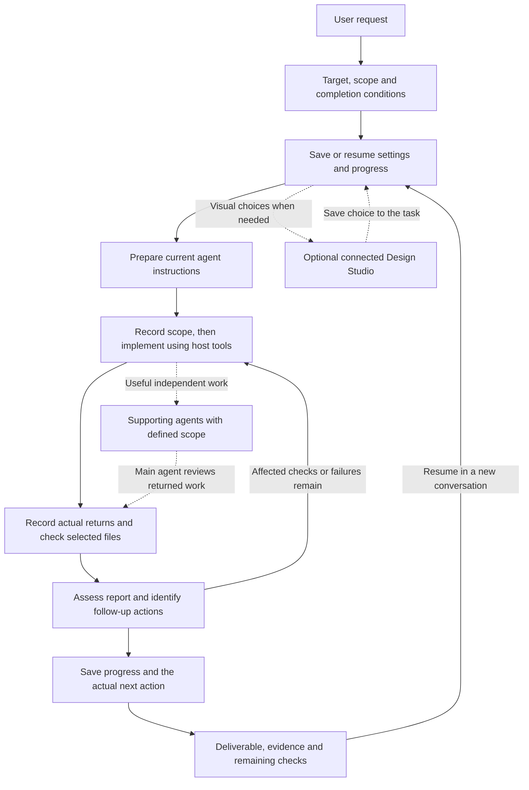
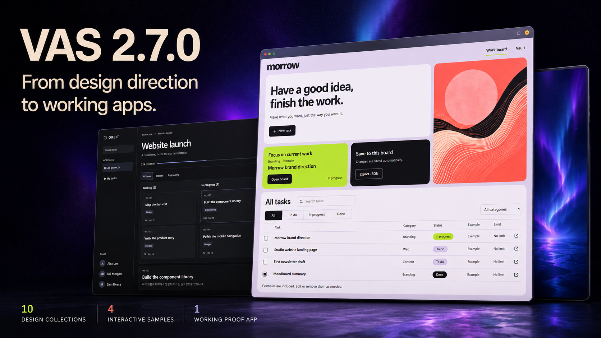

# VAS 2.13.2

**Connecting a folder to your AI app? Select the entire project folder containing `Run-VAS-System.bat`, `src/` and `ui/`.** If the connection shows only `.claude/`, reselect its parent so the agent can read the project instructions and commands.

Build your application in `src/` with a coding agent that carries decisions and checks from one conversation to the next.

VAS (Vibecoding Agent System) is a local workflow tool that helps coding agents turn a user's request into a working deliverable. It carries the agreed target, requirements, scope and completion conditions through task setup, implementation, verification and follow-up work.

The main agent uses VAS to save and resume settings and progress, prepare current instructions, coordinate scoped supporting work, and turn assessment into concrete next actions. Selected file observations help it distinguish checks that still apply from checks affected by later changes. Your coding host supplies the actual file, command, browser and delegation tools. Design choices are one part of that task context, used when the work needs them.

**[Download the Windows project ZIP](https://github.com/zmsqnfl-commits/quintpact-vas/releases/download/v2.13.2/VAS-2.13.2-windows.zip)** · [Get started](#get-started-on-windows) · [2.13.2 release notes](docs/releases/2.13.2.md)

## What’s new in VAS 2.13.2

An agent can resume the same project across remote shell calls when a connector remounts its folder. After implementation it can pass its checks and criterion outcomes to `finish` once. VAS builds the result report against the handoff the agent actually used and records any checks it could not run. Progress notes also preserve relative container mounts such as `./:/app`.

A user verified this workflow in a remotely connected Claude Desktop folder while migrating a menu-board app. The session resumed after a remount, `finish` succeeded on the first attempt, and `start` found the saved progress. [Field verification](docs/releases/2.13.2.md#claude-desktop-field-verification)

## Start a project

Open the whole project in a coding host and ask it to index the folder.

> 폴더 전체 색인해줘

The agent runs `python -B scripts/vas.py start` from the project root. This read-only command reports the app state, current project prompt, session for this folder and next action. An empty starter with no session is a normal first run. If an earlier app came up in the conversation and it is unclear whether to migrate it, the agent asks that question before planning any transfer. Once you have chosen to migrate, it uses that decision and clarifies only the missing scope or acceptance criteria.

For a confirmed, isolated text or style edit, the agent can make the change, perform its check and use the short `finish --summary … --check …` form without creating a private session. For larger work, migrations or deployment it saves or resumes the agreed task, checks the current revision and prepares the handoff before editing. At the end, the agent uses the `finishArguments` from that preparation, adds its actual checks and criterion outcomes, then reads back the saved next action. A paused or blocked segment can be recorded without a result report. `finish` also leaves a minimal sanitized summary under `vas-state/progress/`. A different host can read it with `start` even if its own private session store is empty. The user does not need to write JSON.

Each new `finish` also produces a human-readable Markdown view of the same progress revision, for example `vas-state/progress/000001.md`. A prepared task carries its agreed scope, recorded decisions and remaining work. If the CLI is unavailable, open the Markdown matching the latest numbered `.ok` marker and compare it with the application. The local Windows hub shows the same saved details and file path.

The repository clone, GitHub source archive and Windows ZIP share the same layout. Your new app, its dependency files and deployment configuration belong in the top-level `src/`. VAS commands and screens are in `scripts/` and `ui/`. The root development package belongs to VAS. When migration is requested, `python -B scripts/vas.py import --from "old app source"` previews eligible code. For a requested transfer, append the exact `--apply --expected-plan DIGEST` arguments returned by the preview. Operational data and credentials stay outside this import. [Migration guide](docs/MIGRATION.md) · [Start and finish guide](docs/PROJECT-ROOT.md) · [Optional Claude Code session hook](docs/CLAUDE-START-HOOK.md)

## One connected workflow

Open the whole project in a coding host that reads its root instructions. For example, ask “Build an inventory app here, keep quantities after reload, and check the mobile layout.” The agent reads the saved instructions, inspects the application and asks for information that affects the work.

| Stage | How VAS helps the agent move the work forward |
| --- | --- |
| **1. Clarify the task** | Separate VAS from the application being built or changed. Keep the target, allowed scope and completion conditions together; distinguish blocking decisions from reference questions. |
| **2. Keep usable context** | Resume current settings and the latest progress summary: decisions, changed files, actual checks, unresolved items and the next action. Recheck the real project before continuing. |
| **3. Prepare the work** | Create instructions tied to the current settings and role resources. Missing requirements, unresolved blocking questions or required privacy review prevent a ready handoff. |
| **4. Implement and coordinate** | Record the responsibility, allowed files and selected file observations before actual host work. Collect direct or delegated returns, including failures, timeouts and missing returns. |
| **5. Check and correct** | Connect relevant checks to their original conditions and selected files. Inspect later changes, preserve failed reviews and recheck affected behavior without blindly repeating unaffected checks. |
| **6. Review and continue** | Compare the report with the current handoff, read the follow-up actions, and save a progress checkpoint. Keep execution reports, VAS assessment and user acceptance separate. |



The coding host performs implementation and verification. VAS provides the settings, instructions, selected file observations and comparison tools; host capabilities and permissions determine which actions can actually run.

## What stays connected

- **The request and the real project.** New applications, existing applications and VAS development are distinguished at the start. The agent reads the target project's own instructions, stack and source before making changes.
- **The screen and the next agent task.** The starter hub saves project instructions to a portable `VAS-PROJECT-PROMPT.json`. The main agent reads the current file before starting, resuming, implementing or delegating work. Saving changes does not launch an AI or rewrite an active conversation.
- **The current settings and the next action.** Local sessions retain requirements, constraints, design scope, completion conditions and questions. `blockingQuestions` stop preparation when an implementation decision is unresolved; ordinary `questions` remain reference context. Both lists and `nextStep` travel with the prepared handoff.
- **The main agent and delegated work.** The main agent records the agreed responsibility and file scope before work, then collects actual host returns. Failed reviews, unreturned work and out-of-scope changes stay visible even when another check passes.
- **The implementation report and its relevant files.** A bounded execution record connects original condition IDs and reported checks to selected file fingerprints. Follow-up identifies missing evidence, incompatible reports and affected checks. Unchanged relevant samples can remain reuse candidates after the host confirms the execution evidence.
- **Today's work and the next conversation.** A private session checkpoint holds decisions, changed relative files, performed and unperformed checks, unresolved items and next action. A separate project summary keeps the next host oriented when it can read the same working folder. Independent revision checks prevent stale settings, progress or execution records from overwriting newer work. Resuming still requires the agent to inspect the current application.

These capabilities support feature work, bug fixes and existing-project changes as well as new applications. Existing UI is preserved by default unless the requested scope calls for a change.

## Get started on Windows

**Requirements:** Windows 10 or 11 with PowerShell 5.1 or later. Chat-session commands also need Python 3.10+ available to the coding host. VAS does not bundle a Python interpreter or a coding AI.

1. Clone the repository or download the project. [Source ZIP](https://github.com/zmsqnfl-commits/quintpact-vas/archive/refs/tags/v2.13.2.zip) · [Windows starter](https://github.com/zmsqnfl-commits/quintpact-vas/releases/download/v2.13.2/VAS-2.13.2-windows.zip)
2. For a ZIP, extract the entire archive into a new folder. Rename the project folder before creating its first saved session.
3. Open the folder containing `project-layout.json`, `src/` and `ui/` in Codex or start Claude Code there. Send “폴더 전체 색인해줘” to start setup, or describe a specific task.
4. To edit shared project instructions on screen, double-click `Run-VAS-System.bat`, change **Project working instructions**, and save. Then say “Continue using the saved instructions” in the coding chat. The screen and agent use the same file, including before a private session exists.
5. Continue in the conversation. The main agent reads the latest instructions, saves the agreed task context when available, prepares the work, and uses its host tools to implement and check the application.
6. Review the deliverable and any remaining checks. On the same PC and installation, a new chat can restore saved decisions and progress when the private session store was written successfully. If storage was unavailable, the host can still inspect the app files and continue from them.

```text
your-project/
├── src/                       Your application source
├── ui/                        VAS settings screens and examples
├── scripts/                   VAS commands
├── docs/                      Workflow and usage guides
├── project-layout.json        Identifies this folder as the project
├── .agents/                   Project instructions and design-analysis skill
├── AGENTS.md                  Codex project instructions
├── CLAUDE.md                  Claude Code project instructions
├── Run-VAS-System.bat          Open VAS settings
└── VAS-PROJECT-PROMPT.json     Created when project instructions are saved
```

The root `src/` serves the same purpose in both archives. Keep existing application code, configuration and data in their established locations when resuming a project. Run and package the app using its own entry point and dependencies. [Project-folder guide](docs/PROJECT-ROOT.md)

Saved instructions travel with the project. Private chat sessions and target bindings stay on the PC where they were recorded. Concurrent screen edits require a refresh or comparison, and a failed save is not shown as success. Missing private-store permissions are reported separately from reading the project instructions. Your current explicit request and higher-priority host rules still apply.

**Claude Code.** Start in the project root so Claude Code can read `CLAUDE.md`. A trial on the 2.11.1 starter showed that Claude Code 2.1.316 loaded its instructions, skill and project agents. That trial stopped at authentication before receiving a first reply. [2.11.1 host observations](docs/releases/2.11.1.md)

The host handles the session commands and result format. Users do not need to author a settings file, execution record or result JSON.

For the screen-based handoff alternative, double-click `Run-VAS-System.bat`, choose a new or existing project, fill in the brief and design scope, then copy the prompt into your coding tool with the real application folder open. The separate `VAS-Client-Form-2.13.2.zip` contains a standalone request form for sharing. Downloads include `SHA256SUMS.txt` and `release-manifest.json` for artifact verification. Opening VAS settings does not start your application; use the application's own run command to inspect it.

**Moving an existing app.** Back up the app and extract 2.13.2 into a fresh folder. Transfer your own source, assets, configuration and saved instructions after checking conflicts. The 2.11.x Windows starter used its top-level `src/` for the app. In the 2.11.x GitHub source archive, `src/` contained VAS screens. Private sessions are specific to the installation and PC. [Upgrade guidance](docs/MIGRATION.md) · [Saved settings](docs/CHAT-STATE.md)

For the Korean quick-start guide, see [00-처음-사용하기.txt](00-처음-사용하기.txt).

## Working with agents

VAS provides a shared workflow for the main coding agent and role instructions for supporting work. Native definitions are included for supported Codex and Claude environments; actual availability depends on the host and its permissions.

When independent work would help, the main agent can delegate implementation, design or review with the current task context and a clear file scope. It remains responsible for collecting the result, inspecting the changes and verifying the combined application. If delegation is unavailable or unnecessary, the main agent performs the work in sequence. A role file by itself is not evidence that an agent ran.

`prepare` creates an instruction package. After opening the execution record, the host records each work unit with `work start` before execution and `work finish` after the actual return. It uses `work inspect` to compare selected files. `assess` returns both the conservative assessment and `followUp`, a bounded list of actions such as recover a missing return, fix a failure, rerun an affected check, reconcile evidence or confirm an original manual condition. The host chooses and performs the applicable actions. It uses `finish` to assess what was actually reported, save a checkpoint and confirm its revision and next action.

These records do not execute commands, authenticate host reports or grant new permissions. File fingerprints cover only the selected files at the observed times. A changed setting or checkpoint can make an older execution context stale without implying that application files changed.

Agent reports, VAS assessment and user acceptance remain separate. When a task has only automatic conditions and all relevant evidence is consistent, `followUp.actions` can be empty while the assessment remains `needs-verification`. That does not invent another manual test or approval step. Originally required manual/static conditions remain visible. Further work uses refreshed settings and a new preparation; automatic iteration numbering and a complete result history are not provided.

See [progress and resume](docs/CHAT-PROGRESS.md), [work and file observations](docs/CHAT-WORK.md), [assessment follow-up](docs/CHAT-FOLLOWUP.md), and the [agent workflow](.agents/HANDOFF-WORKFLOW.md) for the host procedure and limits.

## A working deliverable: Morrow

[Morrow](https://zmsqnfl-commits.github.io/quintpact-vas/src/proof-app/index.html?v=2.10.0) is a task-board application built through an earlier VAS handoff workflow, with separate implementation and independent review. It demonstrates a concrete request becoming an application with testable behavior.

You can create and edit tasks, search and filter them, manage due dates and status, archive and restore records, undo the latest deletion, and export JSON. Data persists in the browser. Verification covered keyboard interaction, responsive layouts at 1440, 768, 390 and 320 pixels, and persistence after a 5,001st task. Review found and corrected focus handling, small mobile controls and a save/reload limit mismatch.

The [verification record](docs/verification/README.md) links the request, original handoff, specification and execution results. It is an earlier application example: its original handoff retains VAS 2.6.4 and does not demonstrate every later chat-session feature. Morrow has no accounts, backend, AI API connection, JSON import or cross-device synchronization.

## Design support when the task needs it

The connected Design Studio helps users and agents agree on visual requirements and save them to the same task. It is optional in the conversational workflow. Existing applications preserve their design by default; partial changes name the affected screens or elements, while a redesign requires an explicit choice.

Samples provide **visual elements**, not a platform or a list of features to copy. For example, a subscription sample can inform an inventory app's typography, aligned rows and accent colors without adding billing or checkout. The current request, saved project instructions, constraints and completion conditions define the application. [Design reference scope](docs/DESIGN-REFERENCE-SCOPE.md) explains the shared browser and CLI policy.

For your own reference image, attach the actual image in the coding chat and ask the agent to apply its relevant elements. The bundled **design-analysis** skill covers typography, color, layout, imagery and spacing; it distinguishes what was observed from implementation proposals and maps each choice to the app. No global skill installation, Obsidian connection or new API key is required. The form's attachment count alone does not deliver image pixels. VAS does not upload or analyze images itself; the host must be able to inspect them. See [reference image analysis](docs/DESIGN-ANALYSIS.md).

Application checks include PC and mobile widths, 320 CSS px reflow, empty and long-data states, actual local font use, contrast, keyboard interaction and reload. Bundled font files can be copied into app-owned assets together with their OFL licenses; the app should not depend on a VAS runtime URL. Declaring a font name is not evidence that it loaded, and resizing a browser is not a physical-phone test.

When you use it, **Save to chat settings** commits the selection. The main agent reads the latest settings before continuing. Opening a sample or saving a design does not wake the AI or replace its active conversation context. GitHub Pages previews are separate from the PC's private task store.

[Explore the Design Studio](https://zmsqnfl-commits.github.io/quintpact-vas/src/design-controller.html?v=2.13.2) · [Connect a local task](docs/CHAT-DESIGN.md)

<details>
<summary>View design collections and interactive samples</summary>

### Design directions with real previews

The Design Studio combines distinct compositions, typography, colors, imagery, spacing, and interaction guidance. You can refine the selected style and carry those settings into a sample before copying the handoff.

| Collection | Visual direction | Good fit |
| --- | --- | --- |
| Bento Studio | Irregular modular layouts, lavender and lime, expressive graphics | Creative studios and personal workspaces |
| Aurora Glass | Dark atmosphere and translucent panels | Immersive product interfaces |
| Clay Pop | Soft peach colors and rounded 3D objects | Learning and friendly consumer products |
| Noir Luxe | Dark surfaces, champagne accents, editorial serif type | Premium brands and product showcases |
| Botanical Atelier | Botanical photography, olive tones, warm ivory | Lifestyle and wellness |
| Retro Sunset | Warm retro colors and record-inspired compositions | Music and independent brands |
| Swiss Poster | Strong type, disciplined grids, exhibition-style hierarchy | Events, portfolios, and editorial pages |
| Cyber Deck | Technical consoles and high-contrast information | Developer tools and operational interfaces |
| Kinetic Type | Oversized typography with controllable motion | Creative campaigns and studio presentations |
| Paper Collage | Layered photographs and tactile editorial compositions | Visual storytelling and publications |

The main picker offers **14 curated choices**. The full set of 28 preset definitions remains available for compatibility with earlier saved selections. Fonts, artwork, and preview media are bundled locally, with font license files included.

### Four interactive sample websites

Open these examples from the [Design Studio](https://zmsqnfl-commits.github.io/quintpact-vas/src/design-controller.html?v=2.13.2). Each recommendation includes a screenshot of its rendered site.

| Style | Sample | Working interactions |
| --- | --- | --- |
| Awwwards | **FORM / FIELD** architecture studio | Project disclosures, section navigation, inquiry preview |
| Linear | **ORBIT** project board | Task search, task creation, status changes |
| Stripe | **RELAY** subscription service | Monthly/yearly billing comparison, plan selection |
| Notion | **FIELDNOTES** team wiki | Document search, document opening, checklist updates |

These are demonstrations: inquiry previews do not send messages, and subscription examples do not process payments. Exploring another sample preserves the design settings you started with. Fictional sample content is a visual reference, not your project's business data.



The image is an earlier promotional composition of the app and design samples.

</details>

## Privacy and project boundaries

- Work memory is opt-in and uses confirmed design selections for recommendations. The Windows server enforces consent and the cumulative 10,000-event / 8 MiB limit. Raw work-memory records are not included in the handoff.
- In the screen-based flow, the existing project path belongs in the copied prompt. Chat sessions additionally keep a private local binding for resume; the path is excluded from shared settings, handoff JSON, browser responses and work-memory records.
- Preparing a handoff does not run, copy, or modify the existing target project.
- Runtime pages use local assets and fonts without external font services or CDNs.

## Verification and development

The [2.13.2 release notes](docs/releases/2.13.2.md) describe read-only intake, task preparation and saving a verified checkpoint. [GitHub Actions](https://github.com/zmsqnfl-commits/quintpact-vas/actions) records published workflow runs.

Application verification for 2.11.0 separately inspected Bento, Swiss and external-image examples in Windows Chrome at desktop and mobile widths. It found and corrected example-level font, contrast and long-data issues. Two fresh coding-host runs reached their time limit; the separate rendered checks are not presented as completed autonomous host runs. The [2.11.0 verification record](docs/verification/2.11.0-project-workflow.md) separates those observations from product regressions. The earlier [2.10.0 agent-flow record](docs/verification/2.10.0-agent-flow.md) remains available.

The required gates cover Python contracts and local storage, browser workflows, session/design integration, Windows HTTP behavior and extracted-package contents. Actual-host checks exercise instruction discovery, saved-task resume and result linkage separately. A successful implementation/reviewer delegation exercise does not mean every app run uses subagents; tools and execution records determine that for each run. An application's remaining manual checks stay visible even when its automated checks pass.

The release workflow runs Windows runtime and extracted-package checks before the remaining validation and publication jobs. The [completion policy](docs/completion-policy.md) explains why agent-reported `complete` can still receive a VAS assessment of `needs-verification`.

For source development, install the Node and Python test dependencies and Chromium, then run the checks from the repository directory:

```powershell
npm.cmd ci
python -m pip install -r tests/requirements-dev.txt
npx.cmd playwright install chromium

npm.cmd run agents:build
npm.cmd run knowledge:index
npm.cmd run test:python
npm.cmd run test:browser
npm.cmd run test:package
npm.cmd run agent:security
```

On Windows, use a local or mapped-drive path when npm cannot run from a UNC directory. The optional `npm.cmd run test:release` command includes the ten-run stress suite; run it only when explicitly needed. `agent:verify` runs the actual Python and browser checks, while `agent:security` checks the generated release's file boundaries and source hashes.

| Location | Purpose |
| --- | --- |
| `src/` | Your entire new application, including manifests, deployment configuration and build products |
| `ui/` | VAS screens, contracts, Design Studio and examples |
| `.agents/` | Task bootstrap, session, execution and role instructions |
| `.codex/agents/`, `.claude/agents/` | Native agent definitions for supported hosts |
| `docs/` | Guides, release notes, and verification records |
| `scripts/`, `tests/` | Session preparation and assessment, local runtime, builds and automated checks |
| `dist/` | Generated distributions; excluded from Git |

Further reading: [documentation index](docs/index.md) · [test guide](tests/README.md) · [asset notices](ui/assets/README.md).

## License

VAS is distributed under the [MIT License](LICENSE). See [NOTICE.md](NOTICE.md) for third-party notices.
