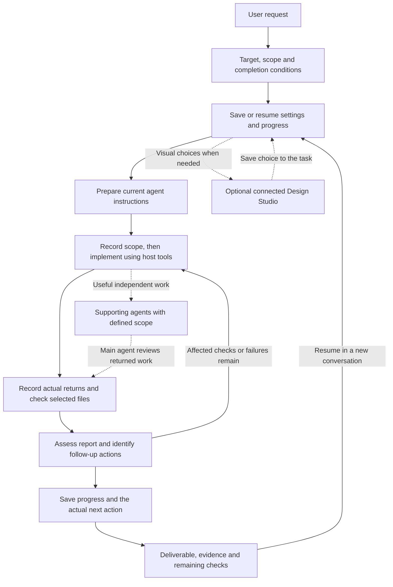
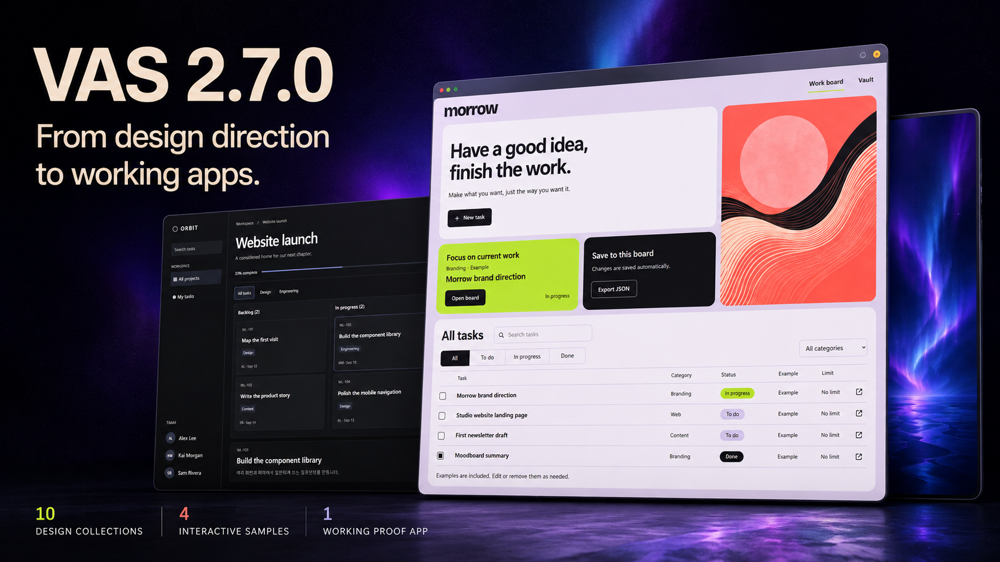

# VAS 2.10.0

**Keep coding agents aligned from request to delivery.**

VAS (Vibecoding Agent System) is a local workflow tool that helps coding agents turn a user's request into a working deliverable. It carries the agreed target, requirements, scope and completion conditions through task setup, implementation, verification and follow-up work.

The main agent uses VAS to save and resume settings and progress, prepare current instructions, coordinate scoped supporting work, and turn assessment into concrete next actions. Selected file observations help it distinguish checks that still apply from checks affected by later changes. Your coding host supplies the actual file, command, browser and delegation tools. Design choices are one part of that task context, used when the work needs them.

**[Download VAS 2.10.0](https://github.com/zmsqnfl-commits/quintpact-vas/releases/tag/v2.10.0)** · **[Get started](#get-started-on-windows)** · **[Implementation and verification](docs/CHAT-EXECUTION.md)** · **[Release notes](docs/releases/2.10.0.md)**

## One connected workflow

Open the extracted **VAS folder** in a coding AI that reads project instructions and describe the work. For example: “Add CSV export to my existing app, keep the current screens, and check that Korean text and totals are preserved.” The agent identifies the actual application, reads its rules and source, and asks only for missing information that affects the work.

| Stage | How VAS helps the agent move the work forward |
| --- | --- |
| **1. Clarify the task** | Separate VAS from the application being built or changed. Keep the target, allowed scope and completion conditions together; distinguish blocking decisions from reference questions. |
| **2. Keep usable context** | Resume current settings and the latest progress summary: decisions, changed files, actual checks, unresolved items and the next action. Recheck the real project before continuing. |
| **3. Prepare the work** | Create instructions tied to the current settings and role resources. Missing requirements, unresolved blocking questions or required privacy review prevent a ready handoff. |
| **4. Implement and coordinate** | Record the responsibility, allowed files and selected file observations before actual host work. Collect direct or delegated returns, including failures, timeouts and missing returns. |
| **5. Check and correct** | Connect relevant checks to their original conditions and selected files. Inspect later changes, preserve failed reviews and recheck affected behavior without blindly repeating unaffected checks. |
| **6. Review and continue** | Compare the report with the current handoff, read the follow-up actions, and save a progress checkpoint. Keep execution reports, VAS assessment and user acceptance separate. |



The coding host performs implementation and verification. VAS provides the settings, instructions, selected file observations and comparison tools; host capabilities and permissions determine which actions can actually run.

## What stays connected

- **The request and the real project.** New applications, existing applications and VAS development are distinguished at the start. The agent reads the target project's own instructions, stack and source before making changes.
- **The current settings and the next action.** Local sessions retain requirements, constraints, design scope, completion conditions and questions. `blockingQuestions` stop preparation when an implementation decision is unresolved; ordinary `questions` remain reference context. Both lists and `nextStep` travel with the prepared handoff.
- **The main agent and delegated work.** The main agent records the agreed responsibility and file scope before work, then collects actual host returns. Failed reviews, unreturned work and out-of-scope changes stay visible even when another check passes.
- **The implementation report and its relevant files.** A bounded execution record connects original condition IDs and reported checks to selected file fingerprints. Follow-up identifies missing evidence, incompatible reports and affected checks. Unchanged relevant samples can remain reuse candidates after the host confirms the execution evidence.
- **Today's work and the next conversation.** A progress checkpoint saves the latest decisions, changed relative files, performed and unperformed checks, unresolved items and next action. Independent revision checks prevent stale settings, progress or execution records from overwriting newer work. Resuming still requires the agent to inspect the current application.

These capabilities support feature work, bug fixes and existing-project changes as well as new applications. Existing UI is preserved by default unless the requested scope calls for a change.

## Get started on Windows

**Requirements:** Windows 10 or 11 with PowerShell 5.1 or later. Chat-session commands also need Python 3.10+ available to the coding host. VAS does not bundle a Python interpreter or a coding AI.

1. Open the [v2.10.0 release](https://github.com/zmsqnfl-commits/quintpact-vas/releases/tag/v2.10.0) and download `VAS-2.10.0-windows.zip`.
2. Extract the entire archive into a stable folder.
3. Open that VAS folder in a coding AI that reads its project instructions, then describe the work. Open a fresh conversation after upgrading the instructions.
4. Continue in the conversation. The main agent saves the agreed settings, prepares the work, reads the target project, and uses its available tools to implement and check it. Visual choices can be added when the task needs them.
5. Review the deliverable, actual checks and remaining conditions. To continue later on the same PC and installation, say “Resume the saved task.” The agent reads the latest settings and progress, rechecks the current files, and works through the remaining actions.

The host handles the session commands and result format. Users do not need to author a settings file, execution record or result JSON.

For the screen-based alternative, double-click `Run-VAS-System.bat`, choose a new or existing project, fill in the brief and design scope, then copy the prompt into your coding tool with the real application folder open. The separate `VAS-Client-Form-2.10.0.zip` contains a standalone request form for sharing. Downloads include `SHA256SUMS.txt` and `release-manifest.json` for artifact verification.

When upgrading, close the old runtime and back up the previous installation and user data. To retain the same installation's task lookup, replace the product at the same stable path and preserve its separate private local settings store. Extraction at another path or movement to another PC does not automatically migrate sessions or target bindings. Copying only the VAS folder or a public settings export does not restore those private bindings. The [settings guide](docs/CHAT-STATE.md) explains these boundaries. Older settings without the new optional fields remain supported.

For the Korean quick-start guide, see [00-처음-사용하기.txt](00-처음-사용하기.txt).

## Working with agents

VAS provides a shared workflow for the main coding agent and role instructions for supporting work. Native definitions are included for supported Codex and Claude environments; actual availability depends on the host and its permissions.

When independent work would help, the main agent can delegate implementation, design or review with the current task context and a clear file scope. It remains responsible for collecting the result, inspecting the changes and verifying the combined application. If delegation is unavailable or unnecessary, the main agent performs the work in sequence. A role file by itself is not evidence that an agent ran.

`prepare` creates an instruction package. After opening the execution record, the host records each work unit with `work start` before execution and `work finish` after the actual return. It uses `work inspect` to compare selected files. `assess` returns both the conservative assessment and `followUp`, a bounded list of actions such as recover a missing return, fix a failure, rerun an affected check, reconcile evidence or confirm an original manual condition. The host chooses and performs the applicable actions, then saves a `checkpoint` and reads it back.

These records do not execute commands, authenticate host reports or grant new permissions. File fingerprints cover only the selected files at the observed times. A changed setting or checkpoint can make an older execution context stale without implying that application files changed.

Agent reports, VAS assessment and user acceptance remain separate. When a task has only automatic conditions and all relevant evidence is consistent, `followUp.actions` can be empty while the assessment remains `needs-verification`. That does not invent another manual test or approval step. Originally required manual/static conditions remain visible. Further work uses refreshed settings and a new preparation; automatic iteration numbering and a complete result history are not provided.

See [progress and resume](docs/CHAT-PROGRESS.md), [work and file observations](docs/CHAT-WORK.md), [assessment follow-up](docs/CHAT-FOLLOWUP.md), and the [agent workflow](.agents/HANDOFF-WORKFLOW.md) for the host procedure and limits.

## What's new in VAS 2.10.0

This release connects task context, actual host work and the next conversation more closely.

- **Ask the questions that matter.** Explicit blocking questions prevent a ready implementation handoff. Reference questions stay available without automatically blocking useful work.
- **Resume progress as well as settings.** One latest checkpoint carries decisions, performed and unperformed checks, remaining issues and the next action. Conflicting or invalid records stay visible instead of being silently overwritten.
- **Connect role returns to scope and selected files.** Record direct or delegated work before it starts, collect its actual return, and detect missing returns, scope violations and changes around a check.
- **Follow the assessment with useful actions.** Identify the affected condition or work unit, keep failed reviews visible, and separate evidence repair from a necessary rerun. Preserve reusable automatic checks when their relevant samples and execution evidence still apply.
- **Keep completion claims precise.** Reported success, file consistency, VAS assessment and user acceptance remain distinct. Valid automatic-only work does not acquire an invented manual acceptance requirement.

The established handoff v3 / result v1 contracts, optional Design Studio and storage protections remain available. Read the [detailed changes and upgrade guidance](docs/releases/2.10.0.md). The earlier [2.9.2 storage and privacy changes](docs/releases/2.9.2.md) and [operations guide](docs/OPERATIONS.md) remain relevant.

## A working deliverable: Morrow

[Morrow](https://zmsqnfl-commits.github.io/quintpact-vas/src/proof-app/index.html?v=2.10.0) is a task-board application built through an earlier VAS handoff workflow, with separate implementation and independent review. It demonstrates a concrete request becoming an application with testable behavior.

You can create and edit tasks, search and filter them, manage due dates and status, archive and restore records, undo the latest deletion, and export JSON. Data persists in the browser. Verification covered keyboard interaction, responsive layouts at 1440, 768, 390 and 320 pixels, and persistence after a 5,001st task. Review found and corrected focus handling, small mobile controls and a save/reload limit mismatch.

The [verification record](docs/verification/README.md) links the request, original handoff, specification and execution results. It is an earlier application example: its original handoff retains VAS 2.6.4 and does not demonstrate every later chat-session feature. Morrow has no accounts, backend, AI API connection, JSON import or cross-device synchronization.

## Design support when the task needs it

The connected Design Studio helps users and agents agree on visual requirements and save them to the same task. It is optional in the conversational workflow. Existing applications preserve their design by default; partial changes name the affected screens or elements, while a redesign requires an explicit choice.

When you use it, **Save to chat settings** commits the selection. The main agent reads the latest settings before continuing. Opening a sample or saving a design does not wake the AI or replace its active conversation context. GitHub Pages previews are separate from the PC's private task store.

[Explore the Design Studio](https://zmsqnfl-commits.github.io/quintpact-vas/src/design-controller.html?v=2.10.0) · [Connect a local task](docs/CHAT-DESIGN.md)

<details>
<summary>View design collections and interactive samples</summary>

### Design directions with real previews

The Design Studio combines distinct compositions, typography, colors, imagery, spacing, and interaction guidance. You can refine the selected style and carry those settings into a sample before copying the handoff.

| Collection | Visual direction | Good fit |
| --- | --- | --- |
| Bento Studio | Irregular modular layouts, lavender and lime, expressive graphics | Creative studios and personal workspaces |
| Aurora Glass | Dark atmosphere and translucent panels | Immersive product interfaces |
| Clay Pop | Soft peach colors and rounded 3D objects | Learning and friendly consumer products |
| Noir Luxe | Dark surfaces, champagne accents, editorial serif type | Premium brands and product showcases |
| Botanical Atelier | Botanical photography, olive tones, warm ivory | Lifestyle and wellness |
| Retro Sunset | Warm retro colors and record-inspired compositions | Music and independent brands |
| Swiss Poster | Strong type, disciplined grids, exhibition-style hierarchy | Events, portfolios, and editorial pages |
| Cyber Deck | Technical consoles and high-contrast information | Developer tools and operational interfaces |
| Kinetic Type | Oversized typography with controllable motion | Creative campaigns and studio presentations |
| Paper Collage | Layered photographs and tactile editorial compositions | Visual storytelling and publications |

The main picker offers **14 curated choices**. The full set of 28 preset definitions remains available for compatibility with earlier saved selections. Fonts, artwork, and preview media are bundled locally, with font license files included.

### Four interactive sample websites

Open these examples from the [Design Studio](https://zmsqnfl-commits.github.io/quintpact-vas/src/design-controller.html?v=2.10.0). Each recommendation includes a screenshot of its rendered site.

| Style | Sample | Working interactions |
| --- | --- | --- |
| Awwwards | **FORM / FIELD** architecture studio | Project disclosures, section navigation, inquiry preview |
| Linear | **ORBIT** project board | Task search, task creation, status changes |
| Stripe | **RELAY** subscription service | Monthly/yearly billing comparison, plan selection |
| Notion | **FIELDNOTES** team wiki | Document search, document opening, checklist updates |

These are demonstrations: inquiry previews do not send messages, and subscription examples do not process payments. Exploring another sample preserves the design settings you started with. Fictional sample content is a visual reference, not your project's business data.



The image is an earlier promotional composition of the app and design samples.

</details>

## Privacy and project boundaries

- Work memory is opt-in and uses confirmed design selections for recommendations. The Windows server enforces consent and the cumulative 10,000-event / 8 MiB limit. Raw work-memory records are not included in the handoff.
- In the screen-based flow, the existing project path belongs in the copied prompt. Chat sessions additionally keep a private local binding for resume; the path is excluded from shared settings, handoff JSON, browser responses and work-memory records.
- Preparing a handoff does not run, copy, or modify the existing target project.
- Runtime pages use local assets and fonts without external font services or CDNs.

## Verification and development

The [2.10.0 release notes](docs/releases/2.10.0.md) describe the release scope and verification boundaries. [GitHub Actions](https://github.com/zmsqnfl-commits/quintpact-vas/actions) records published workflow runs. Release checks and a coding AI's actual application work are different evidence sources.

The [2.10.0 agent-flow verification record](docs/verification/2.10.0-agent-flow.md) describes the tested scenarios and their limits.

The required gates cover Python contracts and local storage, browser workflows, session/design integration, Windows HTTP behavior and extracted-package contents. Actual-host checks exercise instruction discovery, saved-task resume and result linkage separately. A successful implementation/reviewer delegation exercise does not mean every app run uses subagents; tools and execution records determine that for each run. An application's remaining manual checks stay visible even when its automated checks pass.

The release workflow runs Windows runtime and extracted-package checks before the remaining validation and publication jobs. The [completion policy](docs/completion-policy.md) explains why agent-reported `complete` can still receive a VAS assessment of `needs-verification`.

For source development, install the Node and Python test dependencies and Chromium, then run the checks from the repository directory:

```powershell
npm.cmd ci
python -m pip install -r tests/requirements-dev.txt
npx.cmd playwright install chromium

npm.cmd run agents:build
npm.cmd run knowledge:index
npm.cmd run test:python
npm.cmd run test:browser
npm.cmd run test:package
npm.cmd run agent:security
```

On Windows, use a local or mapped-drive path when npm cannot run from a UNC directory. The optional `npm.cmd run test:release` command includes the ten-run stress suite; run it only when explicitly needed. `agent:verify` runs the actual Python and browser checks, while `agent:security` checks the generated release's file boundaries and source hashes.

| Location | Purpose |
| --- | --- |
| `src/` | Setup screens, shared handoff contracts, optional design tools and example apps |
| `.agents/` | Task bootstrap, session, execution and role instructions |
| `.codex/agents/`, `.claude/agents/` | Native agent definitions for supported hosts |
| `docs/` | Guides, release notes, and verification records |
| `scripts/`, `tests/` | Session preparation and assessment, local runtime, builds and automated checks |
| `dist/` | Generated distributions; excluded from Git |

Further reading: [documentation index](docs/index.md) · [test guide](tests/README.md) · [asset notices](src/assets/README.md).

## License

VAS is distributed under the [MIT License](LICENSE). See [NOTICE.md](NOTICE.md) for third-party notices.
