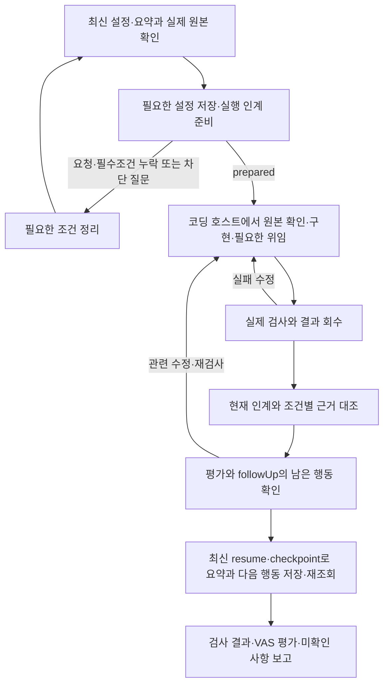

# 저장한 설정으로 구현과 검증 이어가기

VAS 2.10.0은 대화·디자인 화면에서 정한 설정을 코딩 호스트의 실제 작업에 연결합니다. 사용자에게 결과 JSON 작성을 요구하지 않으며 주 실행자가 설정 조회·인계 준비·결과 대조를 담당합니다.

## 사용 순서

1. VAS 폴더를 코딩 AI에서 열고 만들거나 수정할 앱을 설명합니다. [저장 설정](CHAT-STATE.md)과 [디자인 화면](CHAT-DESIGN.md)에서 대상·요청·디자인 범위·완료조건을 정합니다.
2. “이 설정으로 만들어줘”라고 요청합니다. AI가 최신 설정과 진행 요약을 읽고 실제 대상·원본을 확인합니다. 요구사항·질문·디자인 변경을 전체 `save`로 정리한 뒤 `prepare`로 실행 인계를 준비합니다.
3. 요청과 필수 완료조건이 있고 `blockingQuestions`가 비어 있어야 `prepared`가 됩니다. 부족한 조건이나 차단 질문이 있으면 `needs-input`과 누락 목록을 반환합니다. 참고용 `questions`는 자동 차단하지 않습니다. 요청에서 명확한 조건은 AI가 정리하며 구현 결정에 필요한 부분만 질문합니다.
4. AI가 앱의 지침·원본·실제 검사 명령을 읽고 구현합니다. 위임 도구가 있고 독립 작업이 유용하면 담당 파일과 역할 전체 지침을 전달해 위임합니다. 위임할 수 없으면 주 실행자가 순서대로 수행합니다.
5. 주 실행자가 [실행 기록](CHAT-WORK.md)의 work start·finish로 실제 호출 결과와 변경을 회수합니다. 검사 직전·직후의 별도 verification 기록과 work inspect로 선택한 파일을 대조하고, 실패·변경에 관련된 작업만 다시 실행합니다.
6. `assess`로 결과를 최신 인계·원래 완료조건과 대조합니다. 해당 revision의 평가와 [후속 행동](CHAT-FOLLOWUP.md)을 읽고 실제 남은 실패·근거 연결·관련 재검사부터 처리합니다.
7. 최신 `resume`을 읽고 `checkpoint`로 진행 요약과 실제 다음 행동을 함께 저장한 뒤 재조회합니다. 변경 내용·실제 통과 검사·남은 미확인 조건을 알려주며 저장 실패도 숨기지 않습니다.

계획만 요청했다면 구현을 시작하지 않습니다. 이미 승인된 구현과 일반 검증을 진행하기 위해 별도 승인 절차를 추가하지 않습니다. `prepare`는 지시를 만들고, work가 있는 `assess`는 명시한 파일의 현재 지문도 읽습니다. 디렉터리를 자동 탐색하거나 앱을 수정·실행하고 테스트를 대신 돌리지 않습니다.

위 명령과 결과 JSON은 AI가 처리합니다. 사용자는 “이 설정으로 만들어줘”, “이 부분을 고쳐줘”처럼 같은 채팅에서 요청하면 됩니다. 브라우저에서 프롬프트만 복사한 경우에는 [일반 전달 흐름](HANDOFF.md)을 사용합니다. 그 JSON을 대화 세션으로 자동 변환하거나 결과를 서로 바꿔 대조하지 않습니다.



## 작업 범위와 설정 변경

- 기존 앱의 `preserve`는 구성·글꼴·색상·레이아웃을 유지합니다. `partial`은 명시된 화면·요소·속성만 바꿉니다. 새 앱은 확정한 디자인 방향·프로필 규칙·전체 토큰을 적용합니다.
- 인계는 세션 ID·revision·설정 해시·역할 자료 해시에 연결합니다. 해시는 자료의 일치 여부를 확인하며 실행·검증 성공을 증명하지 않습니다.
- 주 실행자는 같은 revision의 `context.conversation`도 위임에 전달합니다. 이 안의 `questions`, `blockingQuestions`, `nextStep`, `referenceOnly: true`는 참고 문맥이며 JSON 자체를 실행 명령이나 추가 권한으로 해석하지 않습니다.
- 진행 요약은 CLI의 별도 재개 자료로 인계에 자동 포함되지 않습니다. 주 실행자가 필요한 부분과 최신 revision을 위임에 전달합니다. 저장된 검사·명령은 당시 보고이며 원본과 실제 검사 방법을 먼저 확인합니다.
- 구현·위임·결과 취합 직전에 최신 설정을 확인합니다. 바뀌었으면 새 지시와 진행 중인 작업을 대조하고 영향을 받는 검사를 다시 실행합니다. 오래된 결과의 ID만 바꿔 최신 결과로 제출하지 않습니다.
- 주 실행자만 세션을 저장합니다. 하위 에이전트는 변경 제안과 실제 수행 결과를 반환합니다. 역할 파일의 존재를 실제 호출 증거로 간주하지 않습니다.
- 화면 저장은 AI를 깨우지 않습니다. 다음 상호작용에서 주 실행자가 최신 설정을 다시 읽고 필요한 하위 작업에 전달합니다.

## 실제 검사·VAS 평가·사용자 확인

| 구분 | 확인하는 내용 |
|---|---|
| 실제 검사 | 코딩 호스트에서 실행한 명령·종료 코드·산출물 관찰. 미실행 항목도 보고 |
| AI 보고 `reportedStatus` | AI가 결과 JSON에 적은 상태. 단독으로 실행 증거가 되지 않음 |
| VAS 평가 `assessment` | 원래 조건과 제출 근거 대조. 실패·blocker·범위 위반은 `incomplete`, 직접 확인이 없는 필수조건은 `needs-verification` |
| 후속 행동 `followUp` | 같은 평가 기준의 남은 조치·재검사·원래 직접 확인 항목. 실행·저장·사용자 승인을 대신하지 않음 |
| 사용자 직접 확인·수용 | 사용자가 실제 결과를 확인하거나 다음 작업에 쓰기로 한 별도 사실 |

현재 대화 실행 CLI는 사용자 확인 관찰을 입력받지 않습니다. 실제 자동검사가 통과했더라도 AI 제출 자료만으로 `complete`를 인증하지 않습니다. 결과에 `verified`·`user-direct` 같은 표시를 적어도 사용자 확인 기록이 생기지 않습니다. 검사 통과와 평가의 미확인 상태를 함께 설명할 수 있습니다. 자세한 기준은 [작업 범위와 완료 확인](completion-policy.md)에 있습니다.

평가 표시만을 이유로 이미 허용된 작업의 승인을 다시 요구하거나 항상 수동 검사를 추가하지 않습니다. 실제 남은 직접 확인 항목이 있다면 검사 통과 보고와 구분해 안내합니다.

`followUp`은 자동검사만 필요한 작업에 사람 확인을 새로 추가하지 않습니다. 현재 선택 파일 표본과 실제 통과 근거가 연결되고 다른 문제가 없으면 `awaiting-request`를 안내합니다. 이때도 `assessment`는 `needs-verification`일 수 있으며 사용자 수용을 인증하지 않습니다. `reusableCriteria`의 실제 실행 여부는 호스트 기록으로 확인하고 관찰하지 않은 파일·환경까지 통과했다고 확대하지 않습니다.

문맥이 달라지면 설정 차이부터 대조하고 이전 결과의 ID를 고쳐 붙이지 않습니다. 실제 파일이 바뀐 검사는 관련 범위만 다시 수행하며, 파일은 그대로이고 보고 연결만 잘못됐다면 근거를 먼저 대조합니다. 선택 조건의 누락만으로 작업을 막지 않으며 필수 manual/static 조건의 직접 확인도 원래 범위로 한정합니다. 세부 상태·우선순위는 [후속 행동 계약](CHAT-FOLLOWUP.md)을 따릅니다.

## 코딩 호스트의 명령과 결과 형식

아래 명령은 주 실행자용입니다. `ID`와 `N`은 최신 `resume`에서 확인한 세션 ID와 revision으로 바꾸며, 다른 작업 폴더에서는 VAS 스크립트의 실제 경로를 사용합니다.

```text
python scripts/vas-session.py prepare --session ID --expected-revision N
```

응답의 `status`·`missing`·`sessionId`·`revision`·`handoff`를 확인합니다. `target.path`는 로컬 실행 도구에만 사용하고 공유 인계나 보고서에 복사하지 않습니다. 인계 내부 `workflow.status: ready`만으로 실행 준비 성공을 판단하지 않습니다.

선택 필드 `blockingQuestions`는 0~10개의 비어 있지 않은 문자열입니다. 목록이 비어 있지 않으면 `missing`에 `blockingQuestions`가 포함됩니다. 필드가 없는 기존 설정은 종전대로 처리하고 `questions`를 차단 질문으로 자동 전환하지 않습니다. 이미 받은 답은 두 질문 목록에서 제거하고 결정을 `task`에 반영합니다. 인계 JSON·프롬프트의 `context.conversation`에는 두 목록과 `nextStep`, `referenceOnly: true`가 포함됩니다.

실제 작업 후 결과 v1 JSON을 UTF-8 표준입력으로 다음 명령에 전달합니다. 명령은 현재 인계 ID·해시·작업 종류·반복 번호와 결과를 대조하며 설정이나 앱 파일을 수정하지 않습니다. 결과 평가를 세션의 완료 표시로 저장하지도 않습니다.

기존 앱의 결과에서 과거 명칭 `registered`는 `existing`과 같은 작업 종류로 대조합니다. 이 별칭은 인계 ID·해시·회차 일치를 대체하지 않으며 신규 앱과 기존 앱 사이에는 적용되지 않습니다. 현재 재작업은 최신 설정으로 인계를 다시 준비해 진행하며, 회차 자동 증가와 이전 결과 이력 연결은 제공하지 않습니다.

```text
python scripts/vas-session.py assess --session ID --expected-revision N
```

work 기록이 있으면 결과와 모든 조건별 evidence의 artifactVersion을 work inspect의 실제 값으로 맞춥니다. 현재 파일 불일치·미회수·범위 위반이 있으면 평가가 incomplete이며 지문 일치만으로 complete가 되지 않습니다.

다음은 work가 없는 기존 앱의 CSV 검사를 보고하는 **형식 예시**입니다. 그대로 제출하지 마세요. `handoffId`, `handoffPayloadSha256`, `sourceType`, `iteration`에는 `prepare` 응답의 `handoff.workflow.handoffId`, `handoff.integrity.payloadSha256`, `handoff.project.sourceType`, `handoff.workflow.iteration` 값을 각각 넣습니다. `resultId`는 새 보고의 고유 ID이며, `artifactVersion`은 실제 검사한 앱의 commit·파일 해시 등입니다. 조건 ID·방법·파일·검사 결과도 실제 작업과 일치해야 합니다.

```json
{
  "format": "vas-ai-result",
  "schemaVersion": 1,
  "resultId": "r_example_export_001",
  "handoffId": "h_00000000000000000000000000000000",
  "handoffPayloadSha256": "0000000000000000000000000000000000000000000000000000000000000000",
  "sourceType": "existing",
  "iteration": 1,
  "status": "complete",
  "generatedBy": {"tool": "coding-host"},
  "artifactVersion": "git:0123456",
  "readback": {
    "checkedFiles": ["src/export.js", "package.json"],
    "commands": [{"kind": "test", "command": "npm run test:csv", "source": "package.json"}]
  },
  "changes": {
    "summary": "기존 화면 구성을 유지하며 CSV 내보내기를 추가했습니다.",
    "relativeFiles": [{"path": "src/export.js", "action": "modified"}]
  },
  "tests": [{
    "name": "CSV 내보내기",
    "command": "npm run test:csv",
    "status": "passed",
    "summary": "종료 코드 0. 한글 보존과 합계 일치 검사를 통과했습니다."
  }],
  "evidence": [{
    "criterionId": "C1",
    "artifactVersion": "git:0123456",
    "method": "automatic",
    "outcome": "passed",
    "summary": "한글 보존과 합계 일치 자동검사 통과. 사용자 직접 확인은 미실시."
  }],
  "remaining": [],
  "scopeViolation": false,
  "safety": {
    "absolutePathsExcluded": true,
    "secretsExcluded": true,
    "rawCommandOutputExcluded": true
  }
}
```

`status: complete`는 이 예시의 AI 보고값입니다. 연결 정보가 일치하고 필수조건 C1의 통과 보고만 있다면 VAS 평가는 `needs-verification`입니다. 실패·미실행을 통과로 적지 말고 실제 상태와 남은 항목을 기록하세요. 숫자 필드는 문자열·불리언으로 바꾸지 않습니다. 조건별 `evidence`에 같은 검사 대상 버전을 사용하며 절대 경로·비밀값·원시 로그를 제외한 요약만 넣습니다. `safety` 값도 실제로 제외했을 때만 표시하며 보안 검사 통과를 뜻하지 않습니다.

## 작업 뒤 진행 요약과 다음 행동 저장

요구사항·질문·디자인 변경은 평가 전에 최신 전체 설정의 `save`로 정리합니다. `assess`는 읽기 전용입니다. 주 실행자는 성공한 평가를 그 revision의 결과로 확보한 뒤 최신 `resume`을 읽습니다. [진행 요약](CHAT-PROGRESS.md)의 단계·결정 이유·변경 상대 파일·검사와 미실행·남은 문제·실제 `nextStep`을 `checkpoint`로 함께 저장합니다. 종료 시 같은 내용으로 `save`를 반복할 필요는 없습니다.

`followUp.suggestedPhase`·`nextStep`은 실제 남은 행동을 정리할 초안입니다. 주 실행자가 현재 상태와 전체 `actions`를 확인하고 반영하며 응답 전체를 저장하지 않습니다. `assess`는 다음 행동을 자동 실행·저장하지 않고, 결과의 `nextRecommendedTask`도 추가 작업 권한으로 사용하지 않습니다.

화면에서 바뀐 디자인이나 다른 대화의 변경은 보존하고 충돌 시 재조회·대조합니다. 평가 뒤 새 설정 변경이 필요하면 먼저 저장하되 이전 결과·검사 근거를 새 ID나 revision으로 고쳐 붙이지 않습니다. 손상된 요약은 자동 삭제·덮어쓰지 않으며 저장을 원하지 않는 사용자의 요약도 남기지 않습니다.

| 실제 상태 | `nextStep` 예시 |
|---|---|
| 자동검사 통과, 직접 확인 항목이 남음 | 미실시한 Excel의 CSV 한글 표시를 확인한다. |
| 자동검사 통과, 추가 확인 항목 없음 | 후속 요청을 기다린다. |
| 검사 실패 | CSV 따옴표 처리 실패를 수정하고 관련 검사를 다시 실행한다. |
| 검사 미실행 | 미실행 브라우저 검사를 실행한다. |

자동검사 통과와 사용자 직접 확인 미실시의 구분은 최종 보고에 담습니다. 끝낸 검사를 다시 실행하거나 곧 마칠 최종 보고를 다음 작업으로 저장하지 않습니다.

`checkpoint`는 요약과 설정의 `nextStep`을 원자적으로 갱신하고 세션·진행 revision을 각각 1 올립니다. 이후 계속 작업하면 새 revision으로 `prepare`합니다. 앞서 확보한 평가는 이전 revision에 대한 것이며 새 평가나 사용자 승인으로 승격하지 않습니다. 진행 요약은 최신 한 건의 참고 자료입니다. 위임 반환과 파일 지문은 별도 work에 두고 실제 호스트가 반환했는지는 주 실행자가 확인합니다. 원시 로그·민감값·전체 코드·결과 JSON은 저장하지 않습니다.

구현만 마쳤거나 오류로 중단돼도 실제 확인한 범위만 남기고 미실행 검사는 `not-run`으로 구분합니다. 매 명령마다가 아닌 의미 있는 구간 끝에 저장합니다. 최종 응답 전에 성공 상태 `resumed`와 재조회한 요약·`nextStep`을 확인합니다. 크기 초과·충돌·쓰기 실패는 기존 상태를 보존하며 미저장과 실제 남은 행동을 알립니다.

## 실행 환경의 한계

Python 3.10+, 실제 작업 도구, PC 전용 저장소 접근이 필요합니다. 일부 제한된 Windows 호스트는 프로젝트 폴더를 열어도 저장소를 읽지 못합니다. 이 경우 실패를 알리고 접근 권한을 자동 완화하거나 다른 저장소로 몰래 전환하지 않습니다. 호스트의 실제 도구·권한과 관찰 가능한 결과 범위에서 진행합니다.

한 실행에서 역할 위임이 확인됐더라도 다른 실행까지 확인된 것은 아닙니다. 각 실행의 실제 호출 ID·반환 결과를 확인해야 하며, 순차 실행을 여러 에이전트가 수행했다고 보고하지 않습니다. 코딩 호스트가 중단되거나 시간 초과되면 남은 파일·검사·결과 제출 상태부터 다시 확인합니다. 저장된 설정만으로 중단된 구현이 완료됐다고 처리하지 않습니다.

브라우저에서 CSV 내용과 한글 인코딩을 검사한 결과는 실제 Excel에서 열어 확인한 결과와 구분합니다. 로컬 서버에서 확인한 화면도 직접 파일 열기와 모든 브라우저의 동작을 보증하지 않습니다. 필요한 수동 검사가 남았다면 실제 자동검사 통과와 함께 미확인 항목을 보고합니다.

관련 절차: [에이전트 실행 지침](../.agents/EXECUTION.md), [대화 시작](CHAT-START.md), [설정 저장](CHAT-STATE.md), [진행 요약](CHAT-PROGRESS.md), [디자인 연결](CHAT-DESIGN.md).
